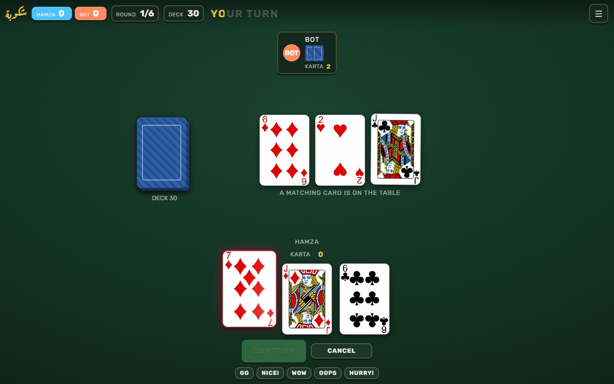
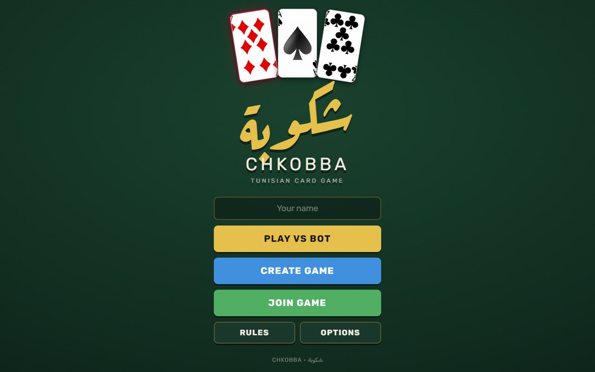
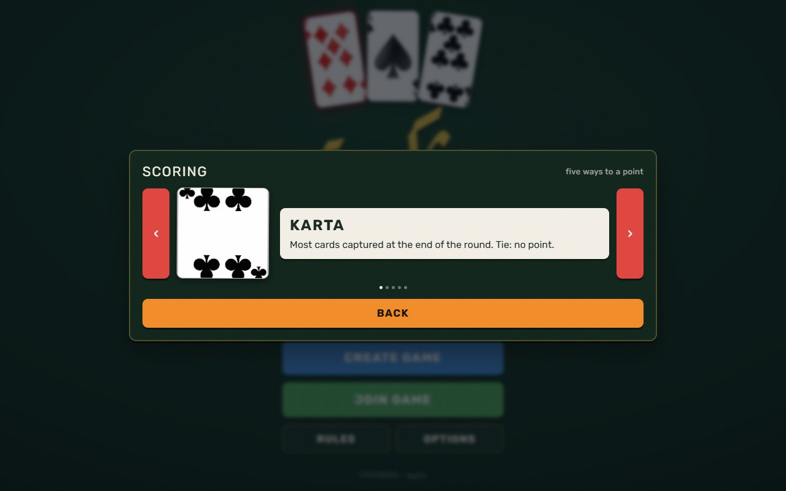
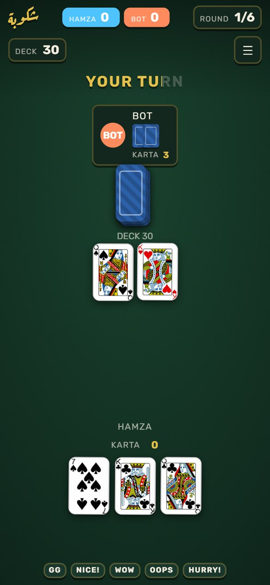

# Chkobba / شكوبة

**The classic Tunisian card game in the browser: play a bot offline, or share a link and play friends online in real time.**

**▶ Play it online: [chkooba.pages.dev](https://chkooba.pages.dev/)**


A multiplayer browser implementation of **Chkobba** (شكوبة), the popular Tunisian card game. A small game server is the referee: it shuffles, deals, checks every move and keeps score, and each player's browser only ever sees its own hand. The server runs on **Cloudflare Workers + Durable Objects** (free plan) or locally on Node. The page itself is vanilla HTML, CSS and JavaScript with no build step.

<p align="center">
  
</p>

<p align="center">
  
  
</p>

<p align="center">
  
</p>

## Features

- **Play vs bot** with three difficulty levels (easy, medium, hard). The hard bot counts cards: it knows its hand, the table, every card already played or taken and how many cards each player holds (never another hand), deals the unseen cards out many times and searches the rest of the deal in each case, playing for its team in 2v2 (no table left for the next opponent to sweep, tables its partner can use, karta, dinari, the 7 of diamonds, barmila, and the last take of the deck). The same hard bot plays offline, in online bot seats and for a dropped player when the room level is hard; in the rooms on a server (the Worker, the Node server) it searches a little less so a move stays within a few milliseconds. Under **Play vs bot**, a **Bot win rate** slider (Off by default, then 0 to 100%, remembered with the room options) makes the offline opponent bots aim for that share of wins, with the same logic as the debug slider below; a 2v2 partner bot is never weakened. It runs entirely in the browser with no server and no network, and no name is required (you play as "Player"). A bot game is saved after every move, so a reload or a closed tab offers **Resume game** on the menu.
- **Online multiplayer** for 2 players, or 4 players in two teams. Share the room code or the invite link; empty seats can be filled with bots. No account and no keys needed.
- **Drops and reloads are fine.** A reload puts you back in the same seat with the same hand. If someone's connection drops, their seat is kept for 60 seconds; after that the others can **let a bot play** the seat, **claim the win**, or keep waiting. A player who comes back gets their seat back, even from the bot.
- **Room options:** win at 5, 11, 21 or 31 points; turn timer (off, or 10 to 60 s); game speed; force capture; capture assist.
- **Looks:** three themes (Felt, Balatro, Noir), three card styles (Photo, Flat, Pixel) and two suit sets (French, Coins). The host's choice applies to the whole room.
- **Personal settings:** screen shake, animations, sound, and labels in Latin, Arabic + Latin, or English.
- **Game feel:** animated deals, card flights, a "chkobba" slam effect, a scored round-end tally and emotes.
- **Card info panel:** long-press, right-click or press `i` on a face-up card to see its value, what it scores and what it can take right now.
- **Phones:** laid out for portrait and landscape, with tap targets of at least 44 px and the notch and home bar kept clear.

## Rules (summary)

- **Players:** 2 or 4. In 4-player mode, players 0+2 form **Team 1** and players 1+3 form **Team 2**.
- **Deck:** 40 cards (Ace to 7 plus Jack, Queen and King in each suit; no 8, 9 or 10).
- **Card values:** Ace = 1, 2 to 7 = face value, Queen = 8, Jack = 9, King = 10.
- **Deal:** the first deal puts 4 cards face up on the table and gives each player 3 cards. Later deals give 3 cards per player only.
- **Play:** on your turn, play one card. Either **place** it on the table, or **capture** table cards whose values add up to its value.
- **Equal card first:** if a table card has the same value as the card you play, you must take that card; a sum is only allowed when no equal card is on the table (7♥ 3♦ 4♣ on the table and a 7 in hand: the 7 takes 7♥, never 3♦+4♣). The referee checks this for every move, including the bot's, and a refused move lights up the card you have to take.
- **Force capture** (room option): while any card in your hand has an equal card on the table, you cannot place a card; you must take it.
- **Chkobba:** clearing the table with a capture scores +1 right away. The dealer cannot score a chkobba on the last card of a round.
- **Deals and rounds:** one round is a whole 40-card deck, played as several deals of 3 cards each (6 deals with 2 players, 3 with 4). The top bar shows the current deal, for example `DEAL 4/6`.
- **End of a deck:** when the hands are empty and the deck runs out, the remaining table cards go to the last team that captured.
- **Points per round:**
  - Most cards captured (*karta*): +1
  - Most diamonds (*dinari*): +1
  - The 7 of diamonds (*haya*): +1
  - Most sevens (*barmila*; tie goes to most sixes, tie again means no point): +1
  - Each chkobba: +1
- **Instant win:** capture all 10 diamonds in one round.
- **Winning:** the first team to reach the chosen score (5, 11, 21 or 31) wins.
- **Capture assist** (off by default): when the host turns it on, cards that can take something are outlined, the matching table cards are highlighted, and if only one take is possible it is picked for you. When it is off, you pick every card yourself and the Capture button lights up only when your picks add up.

### Tips

- Table cards **carry over** between deals. They are only cleared when the deck is empty.
- Double-click a hand card to place it directly (when no capture is required).
- Long-press, right-click or press `i` on a face-up card to open its info panel.

## How online play works

The server is the referee. Each room is one instance of `public/js/room.js`, a referee with no network code of its own: on Cloudflare it lives in a Durable Object (one per room code), locally it lives in a `Map` in `server.js`. Browsers talk to it over a plain WebSocket.

```
 browser (seat 1)                         room CODE (Durable Object)                 browser (seat 0)
 ────────────────                         ──────────────────────────                 ────────────────
 move {game, seq, cardId, captureIds} ──▶ check: turn, card in hand, legal capture
                                          apply, score, run bot seats, timers
 state: public table + MY hand only  ◀─── one snapshot per seat after every change ───▶ public table + MY hand only
 ack {ok | error, reason, mustTake}  ◀───
```

- **Server-authoritative.** The room shuffles with crypto randomness, deals, validates every move (whose turn it is, that the card is in that player's hand, that the capture is legal), scores, and plays bot seats with natural delays. Clients only send intentions.
- **Private hands.** After every change each seat receives a snapshot of the public state plus its own hand. No browser ever receives another hand or the deck order, so nobody can cheat by reading the network, not even the host.
- **The host is just whoever set up the room.** The host picks the options, adds bots, presses Start and, on the round-end tally, taps to deal the next round while the others see "waiting for the host". If the host leaves, lobby control passes to the next player and the game goes on.
- **Sequence numbers.** Every move carries the game token and the move number it was made on, so a retried or out-of-date move is ignored instead of played twice.
- **Requests always settle.** `public/js/net.js` sends requests with acks, pings every 8 seconds, reconnects with backoff, and asks for a full snapshot after any drop or timeout. Every button that waits on the server shows it, then comes back on the answer, an error or a timeout.
- **Seats.** Claiming a seat is atomic (the room handles one message at a time). Each seat gets a token stored in `localStorage` for that room, so a reload resumes the same seat and hand. A dropped seat is held for 60 seconds, then the others decide: a bot plays it, or the game ends with a win for the side still there.
- **Invite links.** `location.origin + '/?room=CODE'`, with a Copy button in the waiting room and the game menu.
- **Play vs bot** runs the very same `room.js` inside the page through a local transport, so the offline game and the online game share one referee.

## Run locally

Node 18 or newer:

```bash
npm install
npm start          # http://localhost:3110  (PORT=8080 npm start to change it)
```

`npm start` serves `public/` and the game rooms from one Node process (`server.js`, express + ws). Open the page in two browser windows to play yourself.

To run the Cloudflare version locally instead (no account needed):

```bash
npx wrangler dev --port 8794
```

## Deploy to Cloudflare

Both parts run on the free plan. No keys or environment secrets are needed.

**1. The Worker (game server + the site).** In the Cloudflare dashboard: **Workers & Pages → Create application → Continue with GitHub** → pick this repo. Project name: `chkobba`. Deploy command: `npx wrangler deploy`. `wrangler.jsonc` already declares the static assets (`public/`), the `Room` Durable Object and its migration. Once deployed, the whole game works at `https://chkobba.<your-account>.workers.dev`.

**2. Optional: a Pages copy of the site.** **Workers & Pages → Create application → Continue to Pages** → pick this repo. Framework preset: **None**. Build command: leave empty. Build output directory: `public`. On a `*.pages.dev` host, `public/server.js` points the page at the Worker (`https://chkobba.hamza-benismail-6.workers.dev`), so the rooms still run in the Worker.

If Cloudflare gives the Pages site a name other than `chkobba.pages.dev`, add that host to `ALLOWED_HOSTS` in `wrangler.jsonc` (comma-separated; subdomains such as preview deploys are included) and redeploy the Worker. If the Worker's own URL is different, change it in `public/server.js`.

The Worker only accepts `/api/*` and `/ws` requests from pages with no `Origin`, its own origin, `localhost`/`127.0.0.1`, or an `https` host listed in `ALLOWED_HOSTS` (or a subdomain of one). Any other site gets `403`.

## Security note

- Hands and the deck order exist only on the server (or, for a bot game, in your own browser). A modified client can only send moves, and every move is checked.
- Room codes are 8 crypto-random characters; seat tokens are 128-bit random values kept in `localStorage`.
- Rooms live in memory and in their Durable Object's storage, which is deleted after everyone leaves or after 6 hours unused. Nothing else is stored.

The older audit of the Firebase version is kept in [`docs/AUDIT.md`](docs/AUDIT.md), with a note on what the server move fixed.

## Project structure

```
chkoba/
├── public/                   # Everything the browser loads (served by the Worker or by npm start)
│   ├── index.html            # Single-page app: menu, options, join, waiting room, game, overlays
│   ├── server.js             # Where the game server is (the Pages copy points at the Worker)
│   ├── game.js               # Client: screens, snapshots, render queue + animation, requests to the room
│   ├── css/
│   │   ├── tokens.css        # Design tokens and the three themes (html[data-theme])
│   │   ├── game.css          # Layout (phones included), frames and pills, cards, effects, overlays
│   │   └── debug.css         # The debug panel (debug() in the console)
│   ├── js/
│   │   ├── rules.js          # Pure rules: legal captures, move check, bot move, round scoring
│   │   ├── room.js           # The referee: seats, dealing, turns, scoring, bots, timers, snapshots
│   │   ├── net.js            # WebSocket client (acks, heartbeat, reconnect) + the local transport
│   │   ├── i18n.js           # Labels (Latin / Arabic / English) and rule text
│   │   ├── shader.js         # WebGL swirl background (themes that use one)
│   │   ├── fire.js           # Pixel fire for the chkobba slam and the tally
│   │   ├── juice.js          # Motion: tags, slam, flights, count-ups, shake, text-fill, sounds
│   │   ├── cards.js          # Card renderer: photo / flat / pixel, French or coin suits
│   │   ├── look.js           # Room look (host-owned) and personal comfort settings
│   │   └── debug.js          # The debug panel: debug() in the console
│   └── images/               # 40 PNG card faces
├── worker/index.js           # Cloudflare Worker: assets, POST /api/rooms, /ws -> Room Durable Object
├── wrangler.jsonc            # Worker config: assets, Durable Object binding and migration, ALLOWED_HOSTS
├── server.js                 # Local server: express static + ws rooms (npm start)
├── src/origin.js             # Origin allowlist shared by the Worker and the local server
├── tests/
│   ├── rules.test.js         # Rules and scoring
│   ├── room.test.js          # The referee: hidden hands, illegal and stale moves, seats, teams, holds
│   ├── server.test.js        # The local server over real HTTP and WebSockets
│   └── e2e/e2e.py            # Playwright end-to-end flows (see Tests)
├── experimentals/            # Standalone UI lab used to design the current look
└── docs/
    ├── AUDIT.md              # Code and security audit (of the Firebase version)
    ├── CHANGES-since-netlify.md  # What changed for players since the Netlify version
    └── screenshots/
```

### Key design decisions

- **A Durable Object per room:** one single-threaded referee per game, close to the first player, with no database to run. Sockets use `ws.accept()` rather than hibernation so the room's timers (bot turns, the turn timer, the 60 s seat hold) keep running. The room is also saved to the object's storage, so a deploy or an eviction does not lose a game.
- **One referee everywhere:** the Durable Object, the Node server and the offline bot game all run `public/js/room.js`, which uses the same `rules.js` as before, so the scoring is unchanged.
- **Full snapshots, not diffs:** every change sends each seat a complete, small snapshot with a revision number. A client that missed something is never out of sync for more than one message.
- **Multi-deck matches with cumulative scores:** full 40-card decks are played one after another, reshuffled each time, until a team reaches the target score.

## Tests

```bash
npm test
```

runs the unit tests with `node --test`: the rules and scoring (`rules.test.js`), the referee (`room.test.js`: no hand or deck order in any message to another seat, illegal moves refused, duplicate and stale moves ignored, reconnecting with the seat token, 4-player team scoring, two rooms side by side, the host leaving, the 60 s hold, timers) the local server (`server.test.js`: bad and unknown room codes, a full room, origins and CORS, reconnecting over a real socket) and the bot levels (`bot-levels.test.js`: easy and medium pinned move for move, the hard bot legal with and without "Bots see all cards"). `node tests/bot-strength.js` (not part of `npm test`) plays matches between the hard bot, the previous hard bot and the see-all hard bot and prints the win rates.

End-to-end checks drive real browser pages with Playwright for Python (`pip install playwright && playwright install chromium`), one browser with a context per player:

```bash
npm start                                                 # then:
python tests/e2e/e2e.py local http://127.0.0.1:3110       # 2-player round by invite link, 4-player teams, reload, offline bot
python tests/e2e/e2e.py away  http://127.0.0.1:3110       # a drop, the 60 s hold, a bot takes the seat
npx wrangler dev --port 8794                              # then:
python tests/e2e/e2e.py online http://127.0.0.1:8794
```

## Debug panel and logging

Type `debug()` in the browser console to open the debug panel (type it again, or press Escape, to close it). It opens verbose logging too.

Every button sends one `debug` message to the room, and the referee (`public/js/room.js`, `DEBUG_OPS`) does the change, so the offline and the online panel are the same code: every hand, the table, the deck, add or remove cards, undo, snapshots, set the turn, scores and chkobbas, move cards between zones, force a deal, a score or a win, bots, teams, "play as" another seat, freeze and spy mode, and **Sees all cards** per bot in Bot Management (off by default; **All bots** On/Off sets every bot at once): a checked bot, whatever its level, plays the hard bot with every hand and the deck order in view, searching the real cards; unchecking it puts that bot back at once. Each bot also gets a **Win rate** slider (0 to 100%, or Off, the default: its normal level): while it is set, the bot mixes the see-all best move with deliberately bad ones so that it wins about that share of matches against a normal hard bot (calibrated with `node tests/bot-strength.js 100 calibrate`); at 100% it always plays the see-all best move. **Deal Control** sets every seat, the host included, to Normal (a fair deal), Good cards (the 7 of diamonds, sevens, diamonds, cards that take or sweep; several Good seats pick in turn by seat order) or Bad cards (low plain cards that take nothing, with a table they cannot take from), from the next deal on; **All normal** resets every seat. The deck stays the 40 cards with the usual hand sizes, only its order changes. These settings live in the room only, go to debug connections only (a guest cannot tell a seat is rigged) and are never saved.

- **Offline bot game:** the room runs in your page and opens the full panel to you.
- **Online game:** the full panel is for the room's host only, as in the first version: the server makes the host's connection a debug connection and sends it full snapshots (every hand, the deck), again after a reconnect too. If host control passes to someone else, the old host's debug connection is turned off. A guest's panel shows only what their browser has (their hand, the table, the state, the room and its seats, the connection, the last messages); other hands and the deck are marked "hidden in online games: the server holds it". Every other connection still receives only its own hand (a unit test checks this while the host debugs). Freeze shows "Game paused by the host" to the others; the debug flag is per connection and never saved.

For verbose logging without the panel, add `?debug=1` to the URL, or set `localStorage.chkoba_debug = "true"`.

## Tech stack

| Layer | Technology |
|-------|-----------|
| UI | Vanilla HTML + CSS (custom design tokens, three themes), WebGL background shader |
| Logic | Vanilla JavaScript (no framework, no build step) |
| Game server | Cloudflare Workers + Durable Objects (free plan), or Node with express + ws |
| Transport | Plain WebSockets with acks, heartbeat and reconnect |

Design and themes by Jihed Jarboui ([@Jyhed](https://github.com/Jyhed)).

## License

© 2026 Hamza Ben Ismail. All rights reserved.
